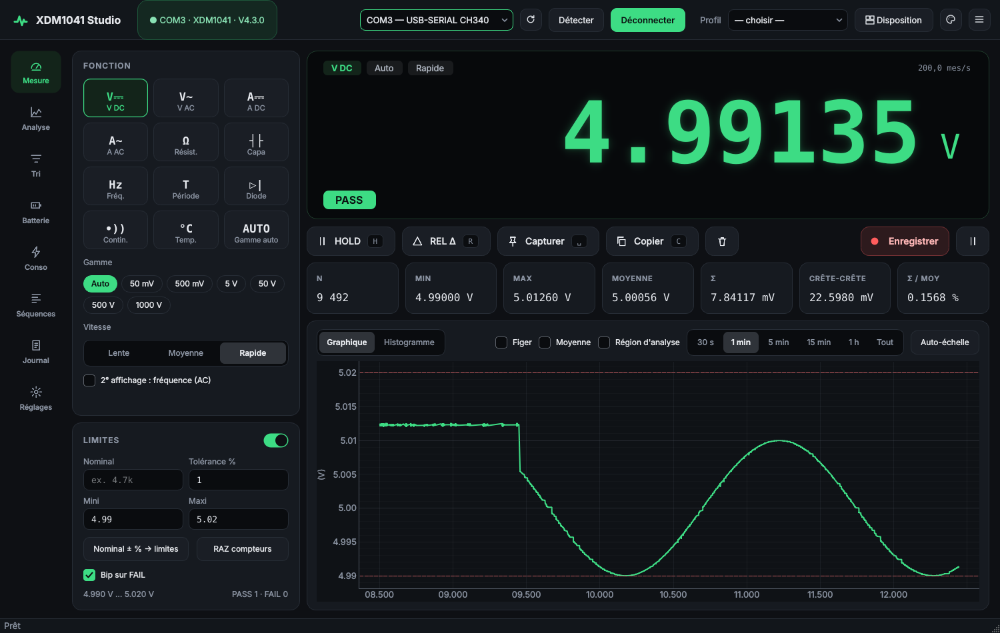
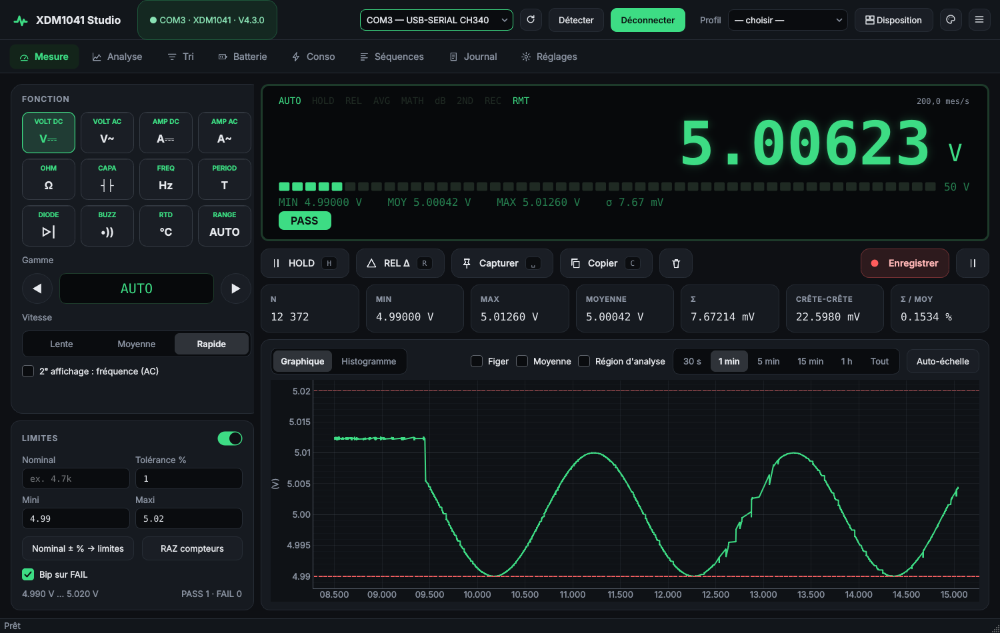
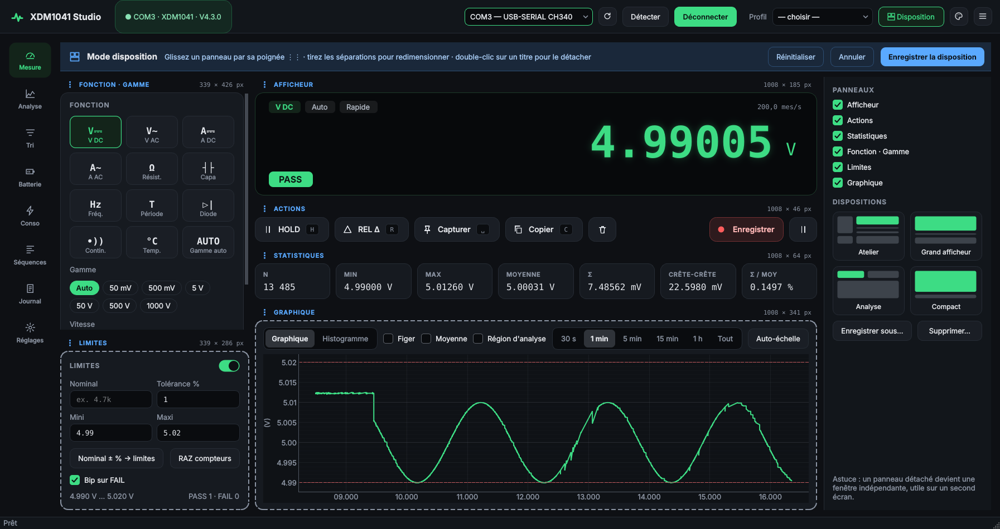
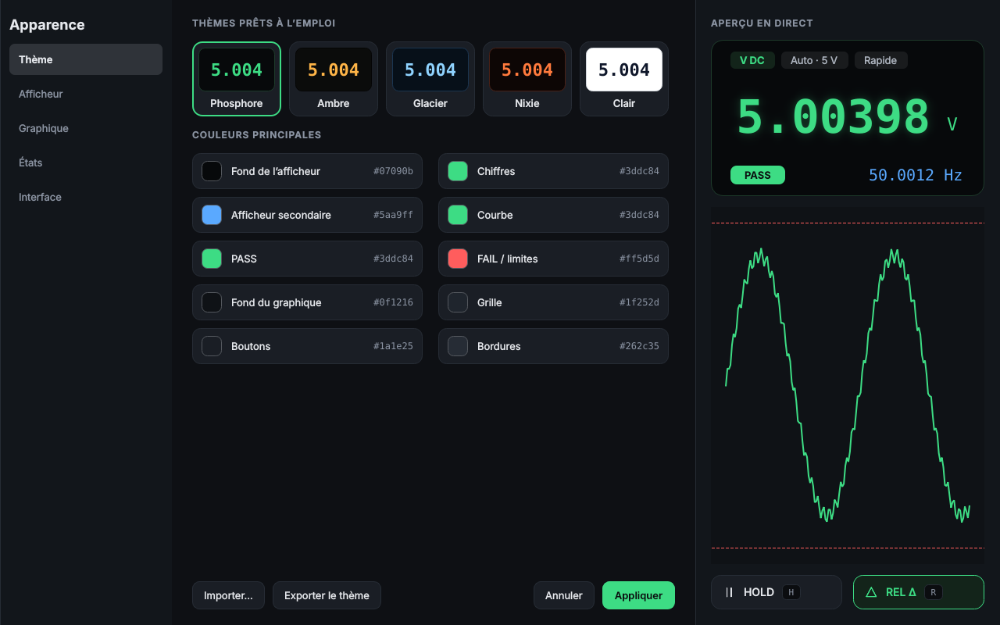
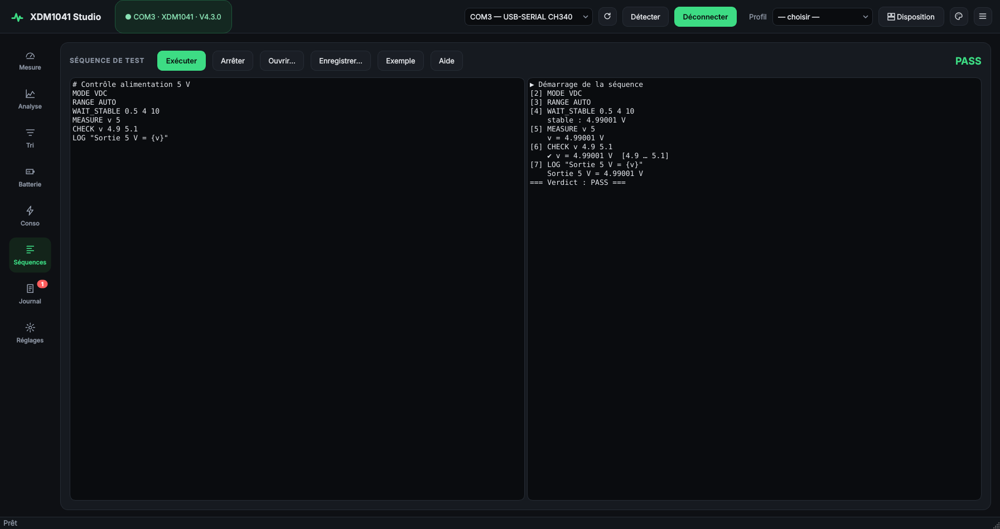

# OWON XDM1041 Studio

Logiciel Windows graphique pour le multimètre de table **OWON XDM1041** (et compatibles SCPI : XDM2041, Victor 8045M…), piloté par le port COM virtuel USB.



| Style Instrument | Mode disposition | Apparence |
|---|---|---|
|  |  |  |

## Téléchargement

Rendez-vous dans [**Releases**](../../releases/latest) :

| Fichier | Usage |
|---|---|
| `XDM1041_Studio_Setup_x.y.exe` | Installateur Windows (menu Démarrer, raccourci bureau, désinstallation) |
| `XDM1041_Studio_portable_x.y.exe` | Exécutable unique, sans installation (démarrage un peu plus lent) |

Windows 10/11 64 bits. Le multimètre apparaît comme un port COM (pilote CH340).

## Fonctions

**Appareil**
- Toutes les fonctions : V DC/AC, A DC/AC, Ω, capacité, fréquence, période, diode, continuité, température PT100/KITS90
- Gammes auto/manuelles (commande `RANGE`, sans réinitialiser les maths), vitesse S/M/F avec détection automatique `S`/`L`
- Second affichage fréquence, maths internes (NULL, dB/dBm, statistiques), buzzer, seuil de continuité
- Détection automatique du port, **reconnexion automatique** après débranchement, état restauré au démarrage

**Mesure et analyse**
- Grand afficheur, HOLD, REL, moyenne glissante, statistiques (min/max/moyenne/σ/crête-crête)
- Graphique temps réel, histogramme, **région d'analyse** (Δt, Δ, pente, stats de la zone)
- Limites PASS/FAIL (saisie SI : `4.7k`, `10m`, nominal ± %)
- **Capture automatique** des valeurs stables et **tri en bacs** E6…E96
- **Surveillance** : pics, OL, décrochages, dérive en %/min — journal d'événements
- **Batterie** : décharge à courant constant ou sur résistance, coupure, Ah/Wh, résistance interne
- **Consommation** : veille/réveil, rapport cyclique, estimation d'autonomie
- **Intégration** : charge (Ah, C) et énergie (Wh)
- **Comparaison** de plusieurs enregistrements CSV

**Atelier**
- **Profils** de mesure enregistrables
- Enregistrement CSV avec **déclencheur** (seuil montant/descendant, heure) et durée
- **Rapport PDF d'intervention** (client, appareil, notes, graphiques, tableaux)
- Export **Excel** avec graphique natif, PNG
- **Afficheur flottant** semi-transparent (F11), annonce **vocale** des mesures
- **Séquences de test** scriptées avec verdict global

**Intégration**
- **Serveur web local** : afficheur + courbe consultables depuis un téléphone
- **MQTT** avec découverte automatique **Home Assistant**
- Console SCPI avec historique

**Interface (v3)**
- Deux styles au choix : **Atelier** (moderne, tuiles) ou **Instrument** (face avant, voyants, barregraphe)
- Navigation par **barre latérale** ou **onglets**
- **Mode disposition** : panneaux déplaçables/redimensionnables à la souris, détachables (second écran), dispositions prédéfinies et personnalisées
- **Apparence** : 5 thèmes (Phosphore, Ambre, Glacier, Nixie, Clair), couleurs éditables, police/taille/halo des chiffres, aperçu en direct, import/export
- Taille de texte réglable (écrans 4K), raccourcis clavier
- **Mises à jour automatiques** : vérification des releases GitHub au démarrage (désactivable dans Options), notes de version, téléchargement vérifié (SHA-256) et installation en un clic — installateur ou exécutable portable


## Raccourcis

| Touche | Action |
|---|---|
| `H` | HOLD |
| `R` | REL Δ |
| `Espace` | Capturer la mesure |
| `P` | Pause / reprise |
| `C` | Copier la valeur |
| `A` | Auto-échelle du graphique |
| `F11` | Afficheur flottant |
| `Ctrl+E` / `Ctrl+Shift+E` | Export CSV / Excel |
| `Ctrl+P` | Rapport PDF |

## Séquences de test



```text
MODE VDC
RANGE AUTO
WAIT_STABLE 0.2 5 15      # tolérance %, nb échantillons, délai max (s)
MEASURE v5 10             # moyenne de 10 mesures
CHECK v5 4.75 5.25        # notation SI acceptée (50m, 4.7k…)
LOG "Tension : {v5}"
```

Commandes : `MODE`, `RANGE`, `RATE`, `SCPI`, `QUERY`, `WAIT`, `WAIT_STABLE`, `MEASURE`, `CHECK`, `PROMPT`, `LOG`, `SAY`, `BEEP`, `STOP_ON_FAIL`. Exemples dans [`examples/`](examples).

## MQTT / Home Assistant

*Options → Configuration MQTT* : serveur, identifiants, préfixe (`xdm1041` par défaut).
Topics : `xdm1041/state` (JSON : `value`, `unit`, `mode`, `pf`, `secondary`, `display`, `ts`) et `xdm1041/status` (`online`/`offline`).
Avec la découverte activée, l'appareil « OWON XDM1041 » apparaît automatiquement avec les capteurs *Mesure*, *Fonction* et *Limites*.

## Protocole

SCPI ASCII sur port COM virtuel USB, **115200 bauds 8N1**, terminaison `\n`.
`SYST:REM` est nécessaire avant toute lecture ; `MEAS1?` / `MEAS2?` renvoient la mesure en notation scientifique, une valeur ≈ `1E+9` signifie dépassement (OL).

Références : [manuel de programmation OWON XDM1041/2041](https://storage.eleshop.eu/files/XDM1000_Digital_Multimeter_Programming_Manual.pdf), [TheHWcave/OWON-XDM1041](https://github.com/TheHWcave/OWON-XDM1041), [e-magnetica](https://e-magnetica.pl/doku.php/miscellaneous/programming_of_owon_xdm1041).

## Compiler depuis les sources

Prérequis : Python 3.11+ ; [Inno Setup 6](https://jrsoftware.org/isinfo.php) pour l'installateur (`winget install JRSoftware.InnoSetup`).

```bat
build.bat
```

Le script crée un environnement virtuel, génère l'icône, compile avec PyInstaller (`dist\XDM1041_Studio\`) puis l'installateur (`installer\`).

Lancement direct : `pip install -r requirements.txt` puis `python xdm1041_studio.py`.

## Licence

MIT
